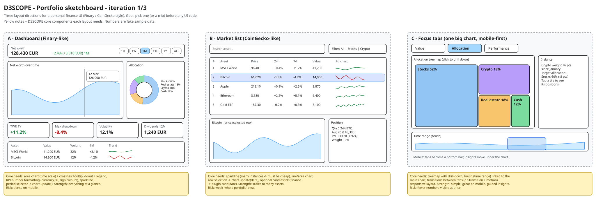

# Portfolio sketchboard

> **Iteration 1 / 3**: three layout directions, to be validated before any UI code.
> Portfolio is a separate project built **on top of** D3SCOPE. This sketchboard
> exists to decide what the **core** must provide (charts, interactions, theming).

- Editable source: [`portfolio-v1.excalidraw`](./portfolio-v1.excalidraw). Drag and drop it onto
  [excalidraw.com](https://excalidraw.com) to edit, or open it with the Excalidraw VS Code extension.
- `portfolio-v1.svg` is a static preview for GitHub.
- All numbers are fake sample data.

## The three directions

|                 | A: Dashboard (Finary-like)                                             | B: Market list (CoinGecko-like)                                | C: Focus tabs (mobile-first)                                                     |
| --------------- | ---------------------------------------------------------------------- | -------------------------------------------------------------- | -------------------------------------------------------------------------------- |
| **Idea**        | Everything at a glance: net worth, history, allocation, KPIs, holdings | List of assets first; select one to see its chart and position | One big chart at a time (Value / Allocation / Performance), with guided insights |
| **Main charts** | Area chart + crosshair, donut, KPI cards, sparklines                   | Sparkline per row, area/line chart for the selection           | Treemap with drill-down, time-range brush                                        |
| **Strength**    | Complete overview                                                      | Scales to many assets                                          | Simple, great on mobile                                                          |
| **Risk**        | Dense on mobile                                                        | Weak "whole portfolio" view                                    | Fewer numbers visible at once                                                    |

## What the core would need (by direction)

| Core capability                              |  A  |   B    |  C  | Notes                                                   |
| -------------------------------------------- | :-: | :----: | :-: | ------------------------------------------------------- |
| Time scale + area/line chart                 | ✅  |   ✅   | ✅  | Already the first chart on the roadmap after bar        |
| Tooltip + crosshair                          | ✅  |   ✅   | ✅  | `interaction/` module                                   |
| Donut / pie + legend                         | ✅  |        |     |                                                         |
| Sparkline (many instances, cheap)            | ✅  |   ✅   |     | Needs a lightweight render path, without axes or legend |
| Treemap with drill-down                      |     |        | ✅  | New chart type for the core                             |
| Brush (time range) linked to another chart   |     |        | ✅  | `interaction/`, links two charts                        |
| Period selector → `chart.update(data)`       | ✅  |   ✅   | ✅  | Data update with `d3-transition`                        |
| Number formatting (currency, %, sign colors) | ✅  |   ✅   | ✅  | `theme/` + formatting helpers, locale-aware             |
| Candlestick                                  |     | (opt.) |     | Finance-specific, so a **plugin** candidate, not core   |
| Animated transitions between views           |     |        | ✅  | `motion` driver (PLAN §6)                               |

## Questions for review

1. **Direction:** keep A, B or C, or a mix? My proposal is **A as the desktop layout + C's tabs on mobile**, with B's sparkline table as A's holdings section.
2. **Charts for the core:** do treemap and brush belong in the core, or in a Portfolio-specific plugin?
3. **Locale:** EUR and French number formatting by default (`128 430 €`), or English (`€128,430`)?
4. **Theme:** light only for v1, or light + dark from the start?
5. **KPIs:** are TWR, max drawdown, volatility and dividends the right four? Other candidates: IRR, fees, cash yield.

Iteration 2 will apply your answers.
