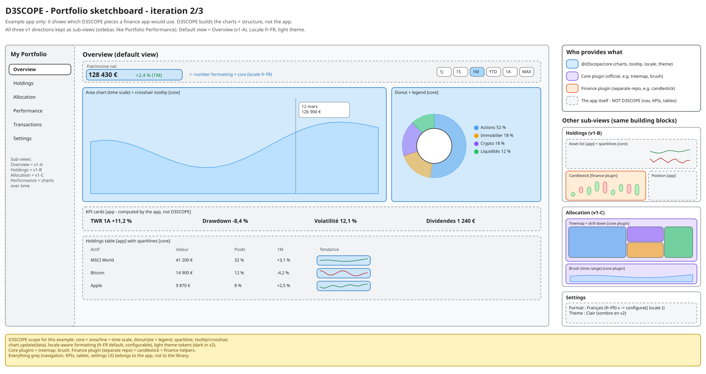

# Portfolio sketchboard

> Portfolio is an **example app** that will be built later, in its own repository, **on top of**
> D3SCOPE. D3SCOPE builds only the **charts and the structure** (core, core plugins, Plugin API).
> This sketchboard decides which pieces the library must provide. It does not design the app.

## Iteration 2 / 3 (validated ✅)

Source: [`portfolio-v2.excalidraw`](./portfolio-v2.excalidraw). Drag and drop it onto
[excalidraw.com](https://excalidraw.com) to edit it. All numbers are fake sample data.

### What changed since iteration 1 (your review)

| Topic             | Decision                                                                                                                            |
| ----------------- | ----------------------------------------------------------------------------------------------------------------------------------- |
| Layout            | Keep **A, B and C** as **sub-views** in a sidebar (like _Portfolio Performance_). The default view is **Overview** (v1-A).          |
| Scope             | D3SCOPE builds the charts and the structure only. Navigation, KPIs, tables and settings UI belong to the app.                       |
| Treemap, brush    | **Core plugins**: official plugins built on the Plugin API.                                                                         |
| Locale            | **fr-FR by default** (`128 430 €`, `+2,4 %`, `12 mars`), configurable (`configure({ locale })`).                                    |
| Theme             | **Light only in v1**. Dark theme in v2.                                                                                             |
| KPIs, candlestick | Finance-specific, out of scope for the library. Candlestick and finance helpers go into a **finance plugin** (separate repository). |

### Who provides what

| Color in the sketch | Provider                      | Pieces used by this example                                                                                                                                   |
| ------------------- | ----------------------------- | ------------------------------------------------------------------------------------------------------------------------------------------------------------- |
| Blue                | `@d3scope/core`               | area/line chart + time scale, crosshair tooltip, donut/pie + legend, sparkline, `chart.update(data)`, locale-aware number/date formatting, light theme tokens |
| Purple              | Core plugins                  | treemap (with drill-down), brush (time range linked to another chart)                                                                                         |
| Orange              | Finance plugin (out of scope) | candlestick, finance helpers                                                                                                                                  |
| Grey, dashed        | The app (not D3SCOPE)         | sidebar, period buttons, KPI cards, tables, settings screen                                                                                                   |

### Review outcome: validated ✅

- **Sparkline stays in core.** All "simple" charts go in core; plugins only hold specific chart utilities.
- **Iteration 2 is final.** There is no iteration 3.
- **Finance charts (orange)** are **out of D3SCOPE's scope**. A finance plugin is built by others on top of D3SCOPE, which only provides the Plugin API, `plugin-template` and the building blocks (see PLAN §4).

## Iteration 1 / 3 (history)

Source: [`portfolio-v1.excalidraw`](./portfolio-v1.excalidraw). Three directions: **A** Dashboard
(Finary-like), **B** Market list (CoinGecko-like), **C** Focus tabs (mobile-first). The review
answers are summarized in the iteration 2 table above.
