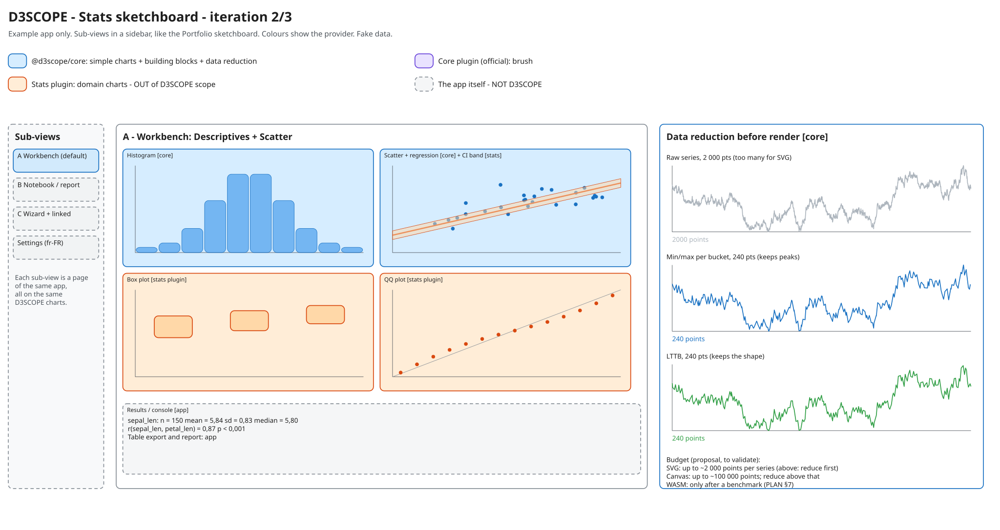
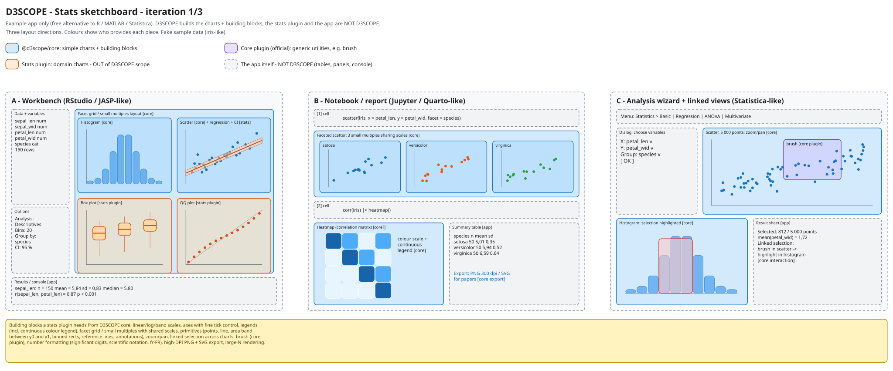

# Stats sketchboard

> Stats is an **example app**: a free, simpler alternative to R, MATLAB or Statistica, built later
> in its own repository **on top of** D3SCOPE. D3SCOPE builds only the **simple charts and the
> building blocks**. Domain charts (box plot, QQ plot, regression, …) belong to a **stats plugin**,
> which is **out of D3SCOPE's scope**. This sketchboard finds which building blocks such a plugin
> needs from the core.

## Iteration 2 / 3 (current)



Source: [`stats-v2.excalidraw`](./stats-v2.excalidraw). Drag and drop it onto
[excalidraw.com](https://excalidraw.com) to edit it. Sample data is fake; numbers use fr-FR.

### What changed since iteration 1 (your review)

| Topic              | Decision                                                                                                      |
| ------------------ | ------------------------------------------------------------------------------------------------------------- |
| Layout             | Sub-views in a sidebar, like Portfolio. **A Workbench** is the default. B and C are the other sub-views.      |
| Histogram, heatmap | **Core** (simple charts).                                                                                     |
| Linked selection   | **Core** interaction. Brush stays a core plugin.                                                              |
| Stats helpers      | Only what is **specific to stats** goes to the stats plugin. Binning stays in core (needed by the histogram). |
| Large datasets     | **Both renderers**: SVG and Canvas. Plus a **data-reduction step** before rendering.                          |

### Data reduction (new)

Reduction runs in **core**, before any renderer. It is a generic data utility, needed by every
line and area chart, not a chart specific to one domain.

| Algorithm                                 | Keeps                                         | Use it for                  |
| ----------------------------------------- | --------------------------------------------- | --------------------------- |
| **Min/max per bucket**                    | the extremes of each bucket (peaks, outliers) | monitoring, raw sensor data |
| **LTTB** (Largest-Triangle-Three-Buckets) | the visual shape of the line                  | time series shown on screen |
| **Decimation** (every n-th point)         | nothing in particular; fast                   | previews only               |

The right panel of the sketch shows the same 2 000-point series reduced to 240 points by
min/max and by LTTB. Both keep the overall shape.

### Proposed point budget (to validate)

| Renderer   | Points per series, before reduction | Rule                                                                                               |
| ---------- | ----------------------------------- | -------------------------------------------------------------------------------------------------- |
| **SVG**    | up to **~2 000**                    | Above this, reduce to ~1 000 first. Each point is a DOM node, and SVG stays readable at that size. |
| **Canvas** | up to **~100 000**                  | Above this, reduce first. Canvas needs no DOM node per point.                                      |
| **WASM**   | not decided                         | Only after a benchmark showing ≥2× end-to-end (PLAN §7).                                           |

Reduction targets roughly one point per horizontal pixel of the chart (about 800–1 000 on a
typical panel), so a line never looks coarser than its screen size.

### Renderer: an option, SVG by default

The renderer is a **chart option**, not an automatic switch. SVG gives the best quality (crisp
text, exact hit-testing, vector export), so it stays the default. Canvas is opt-in, for large
series.

```ts
const chart = createChart(el, {
  type: 'line',
  renderer: 'svg', // default. Set 'canvas' for large series.
  reduce: { algorithm: 'lttb', target: 1000 }, // optional, off by default
  locale: 'fr-FR',
});
```

- `renderer` is set per chart in the options object, and can also be set globally with
  `configure({ renderer })`. The chart option wins.
- When `renderer: 'canvas'` is set, the chart still exports SVG and PNG.
- The budget table above is advice in the docs, not a runtime switch. Above the SVG budget,
  the chart logs a warning suggesting `reduce` or `renderer: 'canvas'`.

### Who provides what

| Colour       | Provider                        | Pieces                                                                                                                                                                                                                                                        |
| ------------ | ------------------------------- | ------------------------------------------------------------------------------------------------------------------------------------------------------------------------------------------------------------------------------------------------------------- |
| Blue         | `@d3scope/core`                 | histogram, scatter + regression line + CI band (drawing), heatmap, facet grid with shared scales, continuous colour legend, zoom/pan, linked selection, **data reduction (min/max, LTTB, decimation)**, SVG and Canvas renderers, export (high-DPI PNG + SVG) |
| Purple       | Core plugin                     | brush                                                                                                                                                                                                                                                         |
| Orange       | Stats plugin (**out of scope**) | box plot, QQ plot, regression and CI computation, quantiles, KDE                                                                                                                                                                                              |
| Grey, dashed | The app (not D3SCOPE)           | sidebar navigation, data table, variable list, dialogs, console, result tables                                                                                                                                                                                |

### Questions for review

1. **Point budget:** does the SVG ~2 000 and Canvas ~100 000 proposal match your expectations? Should the reduction target instead be fixed at ~1 000 points?
2. **Renderer:** confirm `renderer` as a chart option (default `'svg'`), overridable globally with `configure({ renderer })`.

---

## Iteration 1 / 3 (history)



Source: [`stats-v1.excalidraw`](./stats-v1.excalidraw). The three directions were
**A** Workbench (RStudio / JASP-like), **B** Notebook / report (Jupyter / Quarto-like) and
**C** Analysis wizard + linked views (Statistica-like). The answers to its five questions are
in the iteration 2 table above.
